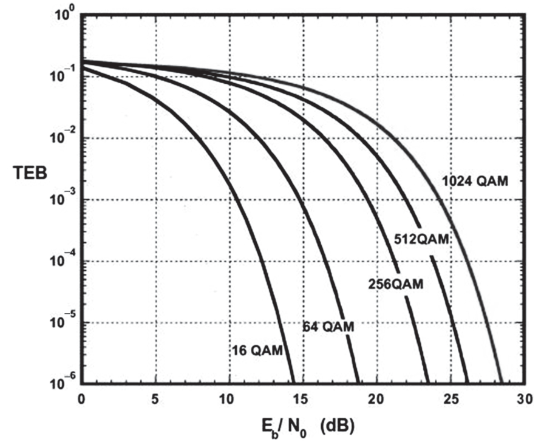

# Registro de estudo — 11/10/2026

Data local: **11/10/2026**, fuso **America/Sao_Paulo**. Fechamento até **20:55:41**, momento do pedido de salvar no GitHub. A virada de data UTC não muda o dia local deste estudo.

## Tempo de estudo

**Estimativa: cerca de 6h15**, pela soma dos intervalos de estudo e exclusão das pausas explícitas. A soma aritmética é **06:14:43**, mas não representa precisão de cronômetro.

| Intervalo local | Duração entre os marcadores |
|---|---:|
| 09:36:42–11:21:55 | 01:45:13 |
| 13:12:27–14:17:05 | 01:04:38 |
| 14:44:27–17:01:11 | 02:16:44 |
| 17:12:48–17:36:02 | 00:23:14 |
| 20:10:47–20:55:41 | 00:44:54 |

Pausas excluídas: almoço 11:21:55–13:12:27; pausa 14:17:05–14:44:27; descanso 17:01:11–17:12:48; pausa 17:36:02–20:10:47.

Estimativa pela soma dos intervalos de conversa entre início/retorno e pausas explícitas. Inclui explicações, cálculos e esperas do atendimento. Não é cronômetro de atividade nem desconta interrupções não sinalizadas; não registrar como horas líquidas medidas.

## Método e validade das métricas

Treino em texto, **uma questão por vez**, cinco alternativasA–E e teoria breve antes de temas novos. O usuário pediu estudar as questões históricas das três provas, alterar valores e preservar os enunciados. Questões conceituais e parâmetros normativos foram mantidos; alternativas numéricas foram recalculadas.

As repetições e mudanças de valores foram explicitamente solicitadas para prática. Não constituem questões inéditas nem um simulado longitudinal limpo. Houve também uma repetição inicial não solicitada, identificada pelo usuário, no conceito de probabilidade. Percentuais abaixo são placares de cada atividade, não uma nota global de domínio.

Foram recuperadas **95 exposições respondidas**, entre prática, reforços e reaplicações. O manifesto de outras5 questões do item 2 está preservado, mas as respostas/nota não foram recuperadas com segurança. Etapas iniciais têm reconstrução parcial: o JSON marca essas limitações e não inventa marcações.

## Resultados por atividade

| Unidade | Atividade | Resultado |
|---|---|---:|
| 1.1 | Conceito de probabilidade | 1/1 (100%) |
| 1.1 | Probabilidades conjuntas | 3/3 (100%) |
| 1.1 | Probabilidade condicional | 2/3 (66.7%) |
| 1.1 | Reforço de probabilidade condicional | 1/2 (50%) |
| 1.1 | Independência estatística | 1/1 (100%) |
| 1.2 | Variáveis, distribuições, médias e TLC | 3/3 (100%) |
| 1.3 | Processos estocásticos, autocorrelação, DEP e gaussianos | 2/3 (66.7%) |
| 1.2 | Item1 — 9 questões históricas adaptadas | 9/9 (100%) |
| 2.1 | Números complexos | 1/2 (50%) |
| 2.2 | Impulso, degrau, exponenciais e período | 1/3 (33.3%) |
| 2.3 | Série e Transformada de Fourier | 3/3 (100%) |
| 2.4 | Convolução contínua/discreta | 3/3 (100%) |
| 2.3 | Item2 — 5 questões Transpetro2023 adaptadas | Sem placar recuperado |
| 3.1 | LIT, Laplace, impulso e degrau | 1/3 (33.3%) |
| 3.2 | Sinais no domínio da frequência | 3/3 (100%) |
| 3.2 | Fixação adicional em frequência | 1/1 (100%) |
| 3.3 | Convolução para saída de LIT | 2/3 (66.7%) |
| 3.3 | Reforço de convolução com degrau | 2/2 (100%) |
| 3.4 | Resposta em frequência | 2/3 (66.7%) |
| 3.5 | Amostragem e Transformada Z | 1/3 (33.3%) |
| 3.1 | Item3 — 9 principais e1 relacionada | 9/10 (90%) |
| 4.1 | Blocos de transmissão e modulação | 5/5 (100%) |
| 4.2 | A/D, SNR, TEB, eficiência e fonte/canal | 4/5 (80%) |
| 4.2 | Reforço de SNR | 2/2 (100%) |
| 4.2 | 11 questões sobre item 4.2 e aplicações | 9/11 (81.8%) |
| 4.2 | Duas questões por erro — QAM e CRC | 3/4 (75%) |
| 4.2 | Bits por símbolo e percentuais | 3/3 (100%) |
| 4.2 | Transferência para gráfico QAM | 0/1 (0%) |

## Item1 — Probabilidade e Processos Estocásticos

Conceito1/1; conjunta3/3; condicional2/3 e reforço 1/2; independência1/1; variáveis/distribuições/médias/TLC3/3. Erro da condicional: o denominador deve restringir o universo à condição; não trocar probabilidade conjunta por condicional.

Processos estocásticos2/3: estacionariedade e momentos corretos; área da DEP=R(0) correta. Atenção: covariância zero implica independência para variáveis conjuntamente gaussianas; marginais gaussianas isoladas não bastam.

Bloco histórico adaptado9/9: Poisson, Markov/distribuição estacionária, binomial, normal/percentil, densidade e normalização, sorteio sem reposição, soma de gaussianas e probabilidade conjunta. MarcaçõesD,B,C,D,A,E,C,B,A. Manifesto completo em[JSON do dia](RESULTADOS_DIA_2026-10-11.json), com fontesTranspetro2018/2023 e Petrobras2012.

## Item2 — Matemática Aplicada a Sinais

Revisados números complexos e Euler, aplicação do módulo às partes real/imaginária, impulso/degrau, decaimento exponencial, período, Fourier e convolução. Recuperação parcial:2.1=1/2;2.2=1/3;2.3=3/3;2.4=3/3. Discussão do fator1/(2j) na modulação por seno. Detalhes adicionais de reforço citados em recuperação não foram somados quando a atribuição entre2.4 e3.3 ficou incerta.

Cinco questões Transpetro2023 adaptadas:Q44,Q49,Q55,Q67,Q70. Preservados os dados do manifesto: triângulo de pico3; convolução y(0)=12; modulação comX2=(2+j2πf)^−1; serra6V e período2s; pulsos±3 em intervalos de largura8. O manifesto contém gabaritos planejados, **não uma nota comprovada do usuário**. NaQ44, uma alternativa foi reparada para evitar ambiguidade de duas respostas no enunciado original.

## Item3 — Sinais e Sistemas

3.1:1/3;3.2:3/3 e fixação adicional1/1;3.3:2/3 e reforço 2/2;3.4:2/3;3.5:1/3 pelas marcações. Uma questão deZ foi declarada como cálculo certo/marcação errada pelo usuário.

Principais esclarecimentos:
- x(2t) é linear, mas variante no tempo.
- Impulso e degrau exigem entradas diferentes:1 e1/s naLaplace.
- O j10 veio de s=jω, comω=10 extraído da entrada cos(10t).
- Inclinação de Bode:−20dB/década por unidade de grau relativo.
- Convolução com degrau produz uma resposta acumulada, como6(1−e^(−2t)).
- Fase: argumento do numerador menos argumento do denominador; passa-altas de primeira ordem tem+45° na frequência de corte.
- Converter t em índice:n=t/T.
- Na fração parcial H=A/(z−0,5)+B/(z−0,5)^2, A=1 eB=0,25. O quadrado está no denominador, não no coeficienteB.
- A=1 vem da comparação dos coeficientes de z após reunir as frações; a minúsculo identifica o polo, A maiúsculo é coeficiente.
- Inversa de1/(z−a)^2 inclui(n−1)a^(n−2)u[n−2].

### Questões históricas do item 3

| Prova/Q | Tema | Marcação | Correta | Resultado/valor |
|---|---|---:|---:|---|
| 2012/Q55 | PCM/Nyquist | D | D | fs=12kHz; Rb=144kbps |
| 2023/Q42 | Laplace/resposta temporal | B | B | y(t)=27e^(−3t)sen(2t) |
| 2023/Q45 | Bode/grau relativo | D | D | grau relativo1 |
| 2023/Q46 | Z e tempo/índice | D | B | n=4; y4=0,641 |
| 2023/Q49 | Convolução discreta | E | E | y0=8 |
| 2023/Q55 | Modulação por cosseno/Fourier | C | C | (1/2)[X2(f−f0)+X2(f+f0)] |
| 2023/Q68 | Equação de diferenças/Z | B | B | H=(z²−4z)/(z²−5z+6) |
| 2023/Q69 | Valor final de degrau | C | C | polos−4,−5; y∞=30/20=1,5 |
| 2023/Q70 | Fourier/pulsos | E | E | G=−j24Sa(3ω)sen(3ω) |
| 2012/Q58 | Canal variante e seletivo | C | C | variante no tempo e seletivo em frequência; adicional relacionada |

Bloco principal8/9, adicionalQ58/2012 correta: **9/10 (90%)** no conjunto. A adicional trata canal variante no tempo e seletivo em frequência, relacionado também a radiopropagação.

## Item4.1 — Blocos de transmissão e modulações

**5/5**. Fonte→codificador de fonte→codificador de canal→modulador→canal; receptor realiza operações correspondentes.

Acertos:12Mbps/código1/2/16QAM/B=1,5Rs→9MHz; quantização; AM comVmax80V eVmin20V→m0,60, semsobremodulação; Carson com45kHz e5kHz→100kHz;8 estados de fase e24Mbps→8PSK/8Mbaud.

## Item4.2 — A/D, indicadores e codificação

Bloco inicial **4/5**:PCM84kbps, TEB2×10^−5, eficiênciaI/III e fonte/FEC/ARQ corretos. ErroSNR: razão linear100 equivale20dB. Reforço **2/2**:15mW/0,015mW→30dB;2mW/20µW→20dB.

### Varredura das três provas

6diretas e5relacionadas, total11:
-2012 diretasQ51,Q55,Q56; relacionadasQ32(CRC),Q52(TDM),Q61(óptica/eficiência).
-2018 diretaQ31; relacionadaQ54(sinal-ruído no satélite).
-2023 diretasQ47,Q50; relacionadaQ53(portadora-ruído no satélite).
Não foi localizada questão dedicada especificamente ao funcionamento doARQ nessas três provas.

### Reaplicação solicitada — todas as11

| Prova/Q | Tema | Marcação | Correta | Solução/valores adaptados |
|---|---|---:|---:|---|
| 2012/Q51 | Compressão/fonte versus canal | B | B | H.261,G.711,G.728; Viterbi é algoritmo de decodificação, Reed-Solomon/BCH/Hamming são códigos de canal |
| 2023/Q47 | QAM/TEB/EbN0 | D | C | 4→8 bits;256QAM; interseção na TEB inicial≈19dB. Original13,2dB→22,4dB (B); gráfico mantido, ponto inicialalterado. |
| 2012/Q55 | PCM | A | A | 8kamostras/s×9=72kbps |
| 2012/Q56 | Eficiência/roll-off/código | E | E | I eIII; η=rlog2M/(1+α) nas condições de filtragem adotadas |
| 2018/Q31 | Quantização | C | C | Arredondar amplitudes para níveis disponíveis |
| 2023/Q50 | Fonte/canal/QAM/banda | D | D | Rc24Mbps;6 bits/símbolo;Rs4Mbaud;B5MHz |
| 2012/Q32 | CRC do IEEE 802.16 | C | D | g=x8+x2+x+1; HCS8 bits; parâmetro normativo não alterado |
| 2012/Q52 | PCM/TDM | C | C | Taxa de voz=22×80=1760kbps; enunciadoadaptadoexplicitou exclusão docontrole |
| 2012/Q61 | Eficiência/banda/distância | D | D | Rb2Mbps;B10MHz;L60km; A corrigida paraD antesdafeedback |
| 2018/Q54 | SNR/enlace satélite | E | E | 10logB=73;C/N11,6dB; EIRP do mapa foi apresentado numericamente |
| 2023/Q53 | C/N/enlace satélite | C | C | 10logB=67;C/N17,6dB |

**9/11 (81,8%)**. Erros naQ47adaptada e no polinômioIEEE 802.16. NaQ61, marcaçãoA foi corrigida paraD antes do feedback e considerada correta.

### Esclarecimento do gráfico e do gabaritoQ47

Original:16QAM/13,2dB; dobrar eficiência→256QAM; mesmaTEB exige aproximadamente22,4dB, alternativaBoriginal.

Adaptada:16QAM/10dB; dobrar eficiência→256QAM; mesmaTEB inicial exige aproximadamente19dB, alternativaCadaptada. O gráfico representa curvas fixas de desempenho e pode ser reutilizado ao alterar o ponto inicial. A explicação poderia ter destacado visualmente o novo ponto e a linha horizontal; registrar essa melhoria de apresentação.

A posição do nome da curva não é o ponto de leitura. Escolher a TEB no eixo vertical, cruzar a curva da modulação calculada e projetar no eixoEb/N0.

### Reforços e declaração final do usuário

Duas porerro: **3/4**; QAM1/2 eCRC 2/2.
-16QAM,+50%,TEB10^−3:4→6 bits→64QAM→15dB. MarcouC, corretaB.
-64QAM,+33⅓%,TEB10^−4:6→8 bits→256QAM→21dB. Ccorreta.
-CRC IEEE 802.16:g=x8+x2+x+1. AcertouA.
-CRC comg=x5+x2+1:5 bits/detecção. Dcorreta.10011 pode ser exemplo deresto5 bits; a representação do gerador é100101 e tem6 coeficientes.

Mais3 sobrebits/percentuais: **3/3**:
-64QAM,+50%→9 bits/512QAM(C).
-16QAM,+25%→5 bits/32QAM(D).
-256QAM,+50%→12 bits/4096QAM(A).

Transferência final:64QAM,+50%,TEB10^−4→512QAM→aproximadamente24dB. MarcouC21dB, corretaD24dB.
Usuário declarou: **“eu errei, mas já sei fazer”**. Interrompido o reforço imediato. Não transformar essa marcação isolada em diagnóstico de que não entende o procedimento; manter eventual revisão espaçada.

## Fórmulas consolidadas

### probability

- P(A|B)=P(A∩B)/P(B)
- Poisson: λ=taxa×intervalo; P(N=k)=e^(−λ)λ^k/k!
- Gaussianas independentes: somar médias e variâncias
- Gaussiano conjunto: covariância zero implica independência

### signals

- s=jω; ω vem da frequência angular da entrada
- y=x*h; h[n−k] permite índices negativos
- Entrada impulso versus degrau: Laplace1 versus1/s
- n=t/T
- Polos estáveis: Re(s)<0; no discreto|z|<1
- Bode:−20dB/década por unidade de grau relativo
- H=A/(z−0,5)+B/(z−0,5)^2; A=1,B=0,25
- O quadrado está no denominador, não no coeficienteB
- Inversa1/(z−a)=a^(n−1)u[n−1]
- Inversa1/(z−a)^2=(n−1)a^(n−2)u[n−2]

### telecom

- Rc=Rb/r; Rs=Rc/log2M
- PCM:fs=2fmax;Rb=nfs;L=2^n
- SNRdB=10log10(Ps/Pn), com potências na mesma unidade
- TEB=bits errados/bits recebidos
- η=Rútil/B; para filtro cosseno levantadoη=rlog2M/(1+α)
- AM:m=(Vmax−Vmin)/(Vmax+Vmin); sobremodulação m>1
- Carson:B≈2(Δf+fmax)
- C/N=EIRP+G/T−Ltot−k_dB−10log10B;B emHz
- Aumento percentual é aplicado a log2M nas condiçõesmantidas;50%→×1,5;25%→×1,25
- FEC corrige dentrodacapacidade semretransmissão;ARQ usa detecção/retransmissão;fonte reduz redundância

### crc

- IEEE 802.16 HCS:g=x8+x2+x+1
- Grau r do gerador→r bits de CRC;gerador temr+1 coeficientes
- g=x5+x2+1→100101;6 coeficientes,CRC5 bits

## Continuidade

- **Próxima sessão:12/10/2026, item 5 — Telefonia e Videoconferência, iniciando5.1 (centrais, comutação, tráfego e ErlangB/C).** Não prolongar automaticamente o reforço de QAM.
- Revisões do dia registradas nos marcosD7(18/10) eD21(01/11); tempo→índice eZ também podem receber retomadaD3(14/10).
- Não considerar todos os capítulos dominados com base em treino guiado ou questões já conhecidas.
- Esta sessão é de Telecom. Em outra frente do repositório foi salvo[Português — O fenômeno urbano](QTI10_Portugues_FenomenoUrbano_resultado_2026-10-11.md):9/10, tempo medido6min12s, erro emvírgula e hífen recuperado. Esse resultado foi preservado, mas não somado às95respostas desta sessão nemao tempoestimado até20:55:41. O timestamp doJSON dePortuguês fica além docorte e não foi usado para estimar horas.
- Enunciados/valores e resultados detalhados disponíveis no[JSON do dia](RESULTADOS_DIA_2026-10-11.json); progresso, resultados, unidades, revisões e banco anti-repetição atualizados.
