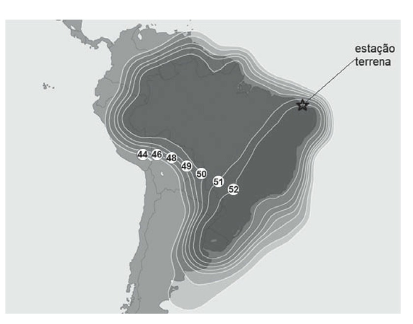

# Estudos de 12/10/2026 — CESGRANRIO/Transpetro Telecom

Data local: **12/10/2026**, America/Sao_Paulo. Fechamento solicitado às 21:59:32. Registro estruturado: [JSON](RESULTADOS_DIA_2026-10-12.json).

## Resultado e ponto de continuidade

Último bloco: **11/11 (100%)**, nas originais de Transpetro 2012, 2018 e 2023. Nenhum erro imediato neste bloco. Ponto atual: **item 7**, após os subitens 7.1 e 7.2 e o bloco noturno. Não tratar o acerto integral como fechamento de todo o edital: o levantamento ampliado com Petrobras ainda não tem resolução completa confirmada.

## Blocos e respostas recuperados

| Bloco | Respostas | Placar | Observação |
|---|---|---|---|
| 5.1 — Centrais, comutação, tráfego, Erlang B/C | B, C, A, B, B | 3/5 | Placar 3/5 recuperado; erros relatados em canais E1 e expansão do somatório Erlang B. Gabarito individual não certificado: recuperações divergem entre D,C,A,E,B e D,C,B,E,B; o segundo não reproduz o placar. Preservar o placar histórico sem inventar o gabarito. |
| 5.2 — Voz/vídeo, multiplexação e sinalização | A, E, A, B, C | 4/5 | Gabarito D,E,A,B,C; erro G.711/H.264. |
| Reforço G.711/H.264 | C, E | 2/2 | Concluído. |
| Item 5 — 15 históricas adaptadas | D, C, B, E, A, C, B, D, B, E, B, D, B, A, E | 13/15 | Erros Q9 (B; correta A) e Q11 (B; correta C/UDP). Q13 H.323 correta B: Q.931, H.245, RTCP. Fontes/números originais/enunciados completos não recuperados. |
| 6.1 — Fundamentos e parâmetros de antenas | B, D, C, E, A | 5/5 | Concluído. |
| 6.2 — Dipolos, plano de terra e monopolos | C, A, A, D, E | 3/5 | Gabarito C,A,E,D,B. Erros Q3 e Q5. |
| 6.3 — Conjuntos e tipos de antenas | C, B, E, B, C | 3/5 | Gabarito D,B,E,A,C. Erros Q1 e Q4. |
| Item 6 — respostas adicionais C,E,D | C, E, D | Nota não recuperada | Sequência visível no histórico do projeto. A correção recuperada menciona 4/4 C,E,B,A em horário anterior aos blocos 6; atribuição inconsistente. Não inferir nota deste bloco nem reatribuir as 4 respostas. |
| Item 6 — 7 históricas adaptadas | D, A, E, B, E, D, A | 6/7 | Erro apenas na Q5 sobre LC. Enunciados/valores alterados não recuperados integralmente. |
| LC — dois reforços | A, B | 2/2 | Concluído. |
| LC — cálculo adicional | B | 1/1 | Resposta B correta; resultado 250 MHz recuperado. Valores L/C do enunciado não recuperados. |
| 7.1 — Propagação, Fresnel, radiovisibilidade e perdas | C, E, A, D, B | 5/5 | Concluído. |
| 7.2 — Equação e dimensionamento de enlace | C, A, D, E, A | 4/5 | Erro inicial em Eb/N0. Reforço 2/2 separado; 6/7 é soma deste bloco e do reforço, não outro bloco. |
| Eb/N0 — reforço | C, E | 2/2 | Concluído. |
| 11 originais Transpetro 2012/2018/2023 | E, B, C, B, A, D, E, C, D, B, C | 11/11 | Enunciados e alternativas originais; resultado integralmente visível na conversa. Reaplicação solicitada pelo usuário; várias famílias já usadas em 11/10, portanto não é diagnóstico longitudinal inédito. |

Contagem **mínima de 78 exposições respondidas** recuperadas, incluindo reforços e reaplicações. Não são 78 questões inéditas, nem contagem exaustiva certificada do dia. Três respostas do item 6 têm nota não recuperada. Não calcular um percentual único de domínio misturando treino, reforços e questões repetidas.

## Evidências anteriores e lacunas

- 5.1: preservado o placar histórico 3/5. Dois gabaritos diferentes foram recuperados; um deles não reproduz o placar. Não fabricar correção individual definitiva.
- 5.2: inicial 4/5, erro em G.711/H.264; reforço 2/2.
- 5.3: as cinco questões iniciais foram apresentadas, mas suas respostas não foram recuperadas. Há prática de SIP/H.323 efetivamente respondida dentro das 15 históricas do item 5.
- Item 5 histórico: 13/15; erros Q9 e Q11. Uma recuperação menciona reforço 4/4 e sequência 17/19, mas a identidade/atribuição das respostas conflita. Preservar essa menção sem acrescentá-la ao total mínimo.
- Item 6: blocos 6.1–6.3 somam 11/15; histórico 6/7, erro LC; reforço LC 2/2 e exercício adicional correto, 250 MHz.
- 7.1: 5/5. 7.2: 4/5, erro em Eb/N0, seguido de 2/2. O 6/7 previamente relatado é a soma do bloco com o reforço; não contar novamente.
- O levantamento anterior foi descrito como 40 adaptações em sete provas (Transpetro 2012/2018/2023 e Petrobras 2012/2011/2010/2006). Essa quantidade é um registro da saída anterior, não uma auditoria de exaustividade realizada neste fechamento. As demais adaptações não têm respostas confirmadas aqui.
- Enunciados alterados dos blocos anteriores não foram recuperados integralmente. As sequências e os placares disponíveis foram preservados; abaixo constam os enunciados originais do último bloco.
- Não foram recuperados novos resultados de Português/Inglês em 12/10. O pedido de QTI de Português de 00:12 UTC de 12/10 corresponde a 21:12 de **11/10** no fuso do usuário e não deve ser transferido para este dia.
- Tempo líquido: **desconhecido**, sem cronômetro ou intervalos/pausas suficientes para estimativa confiável.

## Fórmulas e correções consolidadas

- Tráfego: A = taxa de chamadas × duração média, com unidades compatíveis. Atenção à expansão do somatório de Erlang B; Erlang C inclui espera.
- Telefonia E1 convencional: 30 canais de voz por tributário.
- Ressonância: f0 = 1/(2π√LC); converter nH e pF corretamente.
- Primeira zona de Fresnel: R1 = √[λ d1 d2/(d1+d2)]; neste exercício, usar liberação de 60%.
- Horizonte rádio: d = √(2 R_eq h), com as mesmas unidades de comprimento.
- C/N = EIRP − L_total + G/T + 228,6 − 10 log10(B em Hz). 10 MHz = 10^7 Hz, logo o termo de banda é 70 dB.
- QAM: log2(M) bits/símbolo. Mantendo os demais parâmetros, dobrar os bits/símbolo exige M_novo = M². Na Q47 original: 16 → 256-QAM; mesma TEB → 22,4 dB no gráfico original.
- A Q56/2012 e a Q47/2023 pertencem também a eficiência espectral/modulação (4.2). Questões de satélite têm sobreposição com o item 8; não atribuir todo o bloco exclusivamente ao item 7.

## Último bloco — enunciados e correções

Gabarito e respostas: **E, B, C, B, A, D, E, C, D, B, C**.

### 1. Transpetro 2012 — Q56

Fonte: 05-Co-pia-de-Prova-Engenharia-Telecomunicac-o-es-2012.pdf, página 18; identidade: `CESGRANRIO-TRANSPETRO-2012-Q56`.

Sobre a eficiência espectral (expressa em termos de bps/Hz) da camada física de um sistema de transmissão, considere 
as afirmações a seguir.
I  -  Essa eficiência aumenta com o aumento da quantidade de pontos da constelação da modulação digital.
II  -  Essa eficiência aumenta com o aumento do fator de roll-off do fi ltro cosseno levantado.
III  -  Essa eficiência aumenta com o aumento da taxa do código corretor de erro.
É correto APENAS o que se afirma em
(A) I
(B) II
(C) III
(D) I e II
(E) I e III

**Resposta do usuário: E. Correta: E.** I e III verdadeiras; aumento de roll-off aumenta banda e reduz eficiência.

### 2. Transpetro 2012 — Q57

Fonte: 05-Co-pia-de-Prova-Engenharia-Telecomunicac-o-es-2012.pdf, página 18; identidade: `CESGRANRIO-TRANSPETRO-2012-Q57`.

Com relação aos mecanismos básicos de propagação das comunicações em canais sem fio (wireless), sabe-se que a
(A) difração é o mecanismo mais importante em sistemas de comunicações em visada direta (modelo de dois raios).
(B) difração permite que sinais de rádio se propaguem ao redor da superfície curva da terra (comunicações além do 
horizonte) e por trás de obstruções.
(C) reflexão é fundamental para a realização de transmissão ionosférica na banda de HF. 
(D) dispersão ionosférica é o principal mecanismo de propagação na faixa VLF.
(E) dispersão ocorre quando uma onda de radiofrequência se choca com uma superfície lisa.

**Resposta do usuário: B. Correta: B.** Difração contorna obstáculos e permite propagação além do horizonte.

### 3. Transpetro 2012 — Q58

Fonte: 05-Co-pia-de-Prova-Engenharia-Telecomunicac-o-es-2012.pdf, página 18; identidade: `CESGRANRIO-TRANSPETRO-2012-Q58`.

Seja h(t)=a(t)δ(t)+b(t)δ(t+λ) a resposta ao impulso de um canal de comunicação sem fio. 
Sabendo-se que λ > T, em que T é a duração do símbolo do sistema de transmissão, então esse canal é caracterizado 
pelo efeito de desvanecimento
(A) plano
(B) seletivo em frequência
(C) variante no tempo e seletivo em frequência
(D) de Rice
(E) de Rayleigh

**Resposta do usuário: C. Correta: C.** Resposta C confirmada no gabarito definitivo de 2012. Interpretação da banca: variante no tempo e seletivo em frequência.

### 4. Transpetro 2018 — Q52

Fonte: 04-Co-pia-de-Prova-Engenharia-Telecomunicac-o-es-2018.pdf, página 11; identidade: `CESGRANRIO-TRANSPETRO-2018-Q52`.

Em uma comunicação via satélite utilizando a banda Ku, 
além da perda por propagação no espaço livre, o sinal 
transmitido sofre atenuação significativa devido aos se-
guintes fatores:
(A) absorção pelo vapor d’água não condensado e chuva
(B) cintilação troposférica e chuva
(C) absorção pelo vapor d’água não condensado e rota-
ção de Faraday da polarização linear
(D) cintilação ionosférica e chuva
(E) cintilação ionosférica e cintilação troposférica

**Resposta do usuário: B. Correta: B.** Chuva e cintilação troposférica.

### 5. Transpetro 2018 — Q54

Fonte: 04-Co-pia-de-Prova-Engenharia-Telecomunicac-o-es-2018.pdf, página 12; identidade: `CESGRANRIO-TRANSPETRO-2018-Q54`.

Para o cálculo do enlace de descida (downlink) de um satélite transmitindo na banda Ku, com uma largura de faixa do 
sinal de 10 MHz, utiliza-se o mapa (footprint) de EIRP (em dBW), mostrado na Figura abaixo, no qual está assinalada a 
localidade da estação terrena. 
Além disso, foram obtidos os seguintes dados: perda de propagação no espaço livre = 207 dB; perdas atmosféricas = 6,5 dB; 
Figura de Mérito da estação terrena (G/T) = 19,4 dB/K; e constante de Boltzmann = −228,6 dBW/Hz/K. 
A razão entre a potência do sinal e a potência do ruído, na estação terrena para esse enlace, em dB, é igual a: 
(A) 16,5
(B) 17,3
(C) 17,9
(D) 18,5
(E) 19,3

**Resposta do usuário: A. Correta: A.** EIRP lida no mapa:52dBW; C/N=52−207−6,5+19,4+228,6−70=16,5dB.

### 6. Transpetro 2018 — Q55

Fonte: 04-Co-pia-de-Prova-Engenharia-Telecomunicac-o-es-2018.pdf, página 12; identidade: `CESGRANRIO-TRANSPETRO-2018-Q55`.

Um enlace em rádio deve ser projetado entre 2 pontos que distam 8 Km entre si, com frequência de transmissão de 
1,5 GHz e utilizando antenas de 70 metros de altura em relação ao nível da rua. Na região entre as antenas, será constru-
ído um prédio equidistante das antenas, conforme mostrado na Figura abaixo.
8 km
h
70 m
Considerando aplicável ao problema a teoria de zonas de Fresnel, a máxima altura h desse prédio, em metros, para que 
se possam considerar desprezíveis os efeitos da obstrução à propagação do sinal, é
(A) 70
(B) 65
(C) 60
(D) 58
(E) 50

**Resposta do usuário: D. Correta: D.** λ=0,2m; R1=√(λ d1 d2/(d1+d2))=20m; liberação0,6R1=12m; h=70−12=58m.

### 7. Transpetro 2018 — Q56

Fonte: 04-Co-pia-de-Prova-Engenharia-Telecomunicac-o-es-2018.pdf, página 13; identidade: `CESGRANRIO-TRANSPETRO-2018-Q56`.

O fenômeno de desvanecimento em um sistema de trans-
missão via rádio apresenta, como efeito imediato, o(a)
(A) aumento da potência de ruído no receptor
(B) aumento do raio da primeira zona de Fresnel
(C) redução da taxa de transmissão do sinal digital
(D) redução do ganho da antena de recepção
(E) variação aleatória de parâmetros (fase, polarização e/
ou intensidade) do sinal no receptor

**Resposta do usuário: E. Correta: E.** Banda Ku/propagação: desvanecimento varia fase, polarização e intensidade.

### 8. Transpetro 2023 — Q29

Fonte: 03-Engenharia-de-Telecomunicac-o-es.pdf, página 7; identidade: `CESGRANRIO-TRANSPETRO-2023-Q29`.

Um radiofarol de navegação marítima, via ondas rádio 
na faixa de LF, foi instalado na costa brasileira para guiar 
navios. O farol encontra-se em uma cota de 12 metros 
de elevação, bem próximo da costa, e transmite um si
nal com polarização vertical. Considere que as antenas 
de navegação dos navios possuem uma altura média de 
5 metros. 
Sabendo-se que a permissividade relativa do ar é 1, e a 
da água é 81, qual é o valor, em m, mais aproximado da 
distância que um navio deve estar do farol, para que a 
onda rádio refletida no mar não interfira com a onda di
reta?
(A) 45 
(B) 63 
(C) 153 
(D) 612 
(E) 1.377

**Resposta do usuário: C. Correta: C.** Brewster com polarização vertical: d=(12+5)√(81/1)=153m.

### 9. Transpetro 2023 — Q30

Fonte: 03-Engenharia-de-Telecomunicac-o-es.pdf, página 8; identidade: `CESGRANRIO-TRANSPETRO-2023-Q30`.

Para um enlace rádio ser considerado sobre Terra Plana, 
a distância para o Horizonte Rádio deve ser calculada. É 
necessária a instalação de uma antena no alto de uma 
torre de 2,9 metros, que será instalada em uma elevação 
de 19,6 metros, sem nenhum obstáculo ao redor que blo-
queie o Horizonte Rádio. 
Considerando-se que o raio equivalente da Terra no local 
escolhido é de 8.450 km, qual é o valor, em km, que mais 
se aproxima da distância para o Horizonte Rádio dessa 
antena?
(A) 4,1 
(B) 7,0 
(C) 18,2
(D) 19,5 
(E) 31,0

**Resposta do usuário: D. Correta: D.** h=2,9+19,6=22,5m=0,0225km; d=√(2×8450×0,0225)=19,5km.

### 10. Transpetro 2023 — Q47

Fonte: 03-Engenharia-de-Telecomunicac-o-es.pdf, página 11; identidade: `CESGRANRIO-TRANSPETRO-2023-Q47`.

Em uma transmissão digital, é possível empregar apenas modulação M QAM, M ∈ {16, 64, 256, 512, 1024}, que apresenta 
desempenho em termos de TEB (taxa de erro de bit) versus razão Eb / N0 (Eb – energia por bit; N0 – amplitude da densi
dade espectral de potência do ruído), mostrado na Figura abaixo. 
Em uma implementação inicial do sistema, a modulação utilizada é a 16 QAM, e a razão Eb / N0  conseguida no enlace 
é de 13,2 dB. Em uma segunda fase do projeto, deseja-se dobrar a eficiência espectral da transmissão pelo uso de uma 
outra modulação, mantendo-se a mesma TEB.
Qual deve ser, aproximadamente, o valor da razão Eb / N0, em dB, para atender a essa condição?
(A)	17,7
(B)	22,4
(C)	25,1
(D)	27,5
(E)	28,5

**Resposta do usuário: B. Correta: B.** 16QAM=4bits/símbolo; dobrar→8bits/símbolo→256QAM; mesma TEB→22,4dB pelo gráfico.

### 11. Transpetro 2023 — Q53

Fonte: 03-Engenharia-de-Telecomunicac-o-es.pdf, página 12; identidade: `CESGRANRIO-TRANSPETRO-2023-Q53`.

Em um enlace de descida de um sistema de comunicação 
via satélite, na localidade da estação terrena, tem-se que: 
EIRP = 50 dBW; fator (G/T) = 5 dB/K e perda por propaga
ção no espaço livre Lel  = 204 dB. 
Considerando-se que a banda alocada para transmissão é 
10 MHz, e desprezando-se as demais perdas de potência, 
o valor da razão portadora-ruído no receptor, em dB, é:
(A) 5,4
(B) 7,6
(C) 9,6
(D) 11,4
(E) 13,6
Dado
Constante de Boltzmann = - 228,6 dB W / K / Hz

**Resposta do usuário: C. Correta: C.** C/N=50+5−204+228,6−70=9,6dB.

## Fontes persistentes e método

PDFs originais anexados ao projeto: Transpetro 2012, 2018 e 2023. O gabarito definitivo de 2012 confirma Q56 E, Q57 B e Q58 C: [documento CESGRANRIO](https://eticaconcursos.com.br/provas/arquivos/gabarito/cesgranrio-2012-transpetro-tecnico-de-manutencao-junior-automacao-gabarito.pdf).

Figura Q47 reutilizada de [asset preservado em 11/10](assets/2026-10-11/Q47_Transpetro_2023_grafico.png). Mapa Q54 preservado em [SVG](assets/2026-10-12/Q54_Transpetro_2018_mapa.svg).

Treino guiado com reaplicações solicitadas, **não diagnóstico longitudinal inédito**. Registrar a recuperação sem apagar usos e erros anteriores. Preservar cinco alternativas. Nas adaptações, alterar valores somente com figuras coerentes e manter parâmetros normativos.

## Revisões e próxima retomada

D7: **19/10/2026**. D21: **02/11/2026**. Agendamentos registrados em data/REVISOES.json para os subitens estudados; não são lembretes automáticos.

Retomar pendências do levantamento histórico do item 7; conferir cobertura antes de avançar ao item 8. Manter retestes localizados de E1/Erlang B, voz/vídeo, antenas/LC e Eb/N0, respeitando o histórico de repetição.
